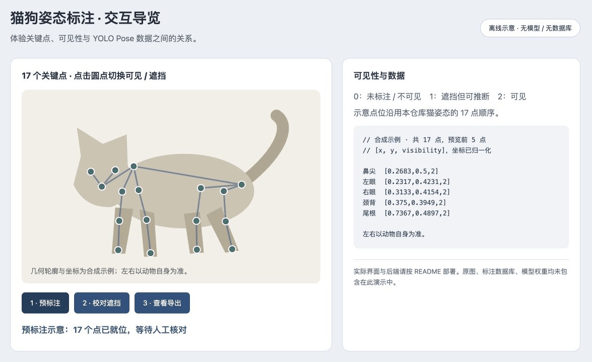

# 标注工作流 · 离线交互说明

克隆仓库后直接打开 [label-demo.html](label-demo.html)，或从仓库根目录运行 `python3 -m http.server 8080 --bind 127.0.0.1`，访问 `/docs/showcase/label-demo.html`。无需登录、模型或数据库；页面不读取或上传文件。

1. **预标注**：显示合成轮廓上的 17 个示例点。
2. **校对遮挡**：将“右眼”设为 `1`，表示遮挡但可推断。还可点击点位在 `1` 和 `2` 之间切换。
3. **查看导出**：显示类别、归一化框和 17 组 `(x, y, visibility)` 的 YOLO Pose 示例。

点位名称与顺序依据 [猫姿态配置脚本](../../scripts/create_cat_pose_keypoint_project.py)。可见性含义：`0` 未标注 / 不可见，`1` 遮挡但可推断，`2` 可见。左右以动物自身为准。此演示不实现未放置点的交互，实际标注中不放置的点由导出工具写为 `0`。

GIF 是本页三个步骤的截图导览，**不是上游 Label Studio 的实际 UI，也不代表 YOLO 预标注精度**。轮廓、框和坐标均为合成示例。真实系统部署与后端接入见 [项目 README](../../README.md)；实际 YOLO Pose 导出见 [导出脚本](../../scripts/export_cat_pose_yolo_pose.py)。

仓库只新增本目录明确列出的文档展示文件；原始图片、视频、标签导出、数据库与模型权重继续由原有忽略规则保护。
